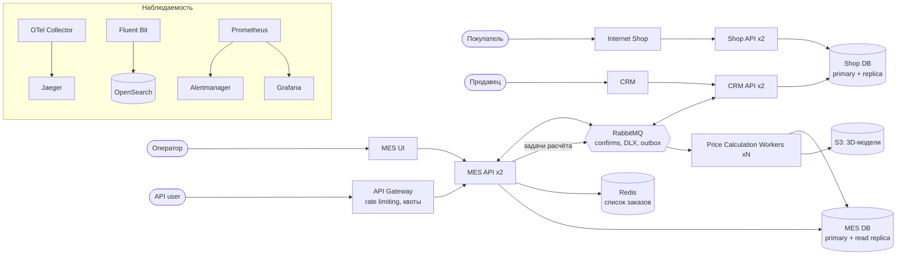

# Планирование: анализ, идентификация проблем и поиск решений

## 1. Исходная ситуация

«Александрит» делает украшения на заказ. Заказ проходит через три системы:

| Система | Технологии | Роль в заказе |
|---|---|---|
| Интернет-магазин (Shop) | Vue + Java Spring Boot, PostgreSQL (Shop DB), S3 | Создание заказа, загрузка 3D-модели: статусы INITIATED, FILE_UPLOADED, SUBMITTED |
| CRM | Vue + Java Spring Boot, та же Shop DB | Работа продавцов: подтверждение производства, закрытие заказа: MANUFACTURING_APPROVED, CLOSED |
| MES (куплена с исходным кодом) | React + C#, PostgreSQL (MES DB) | Расчёт цены, назначение на операторов, производство: PRICE_CALCULATED, MANUFACTURING_STARTED … SHIPPED |

Системы обмениваются сообщениями через RabbitMQ (интеграция написана своими силами). С II квартала MES открывает публичный API для других ювелирных продавцов. Заказ от API user создаётся в CRM по сообщению из очереди.

Симптомы, о которых говорит бизнес:

- заказы выполняются месяцами вместо трёх недель, хотя производство загружено вдвое меньше возможного;
- пользователи API каждый день сообщают о потерянных заказах;
- у операторов MES медленно открывается главная страница со списком заказов, а им важно первыми увидеть новые заказы;
- компания потеряла крупные контракты, недовольство B2C-клиентов растёт;
- релизы задерживаются: E2E-тестирование ручное, на него уходит всё больше времени.

## 2. Проблемы

### 2.1. Существующие проблемы

| № | Проблема | Почему возникает | Последствия |
|---|---|---|---|
| П1 | **Нет наблюдаемости.** Нет мониторинга, централизованных логов и трейсинга | Каждая система пишет логи локально на своём инстансе, метрики не собираются | Нельзя ответить, где заказ потерялся или завис и почему. Жалобы разбираются вручную, причины не устраняются |
| П2 | **Заказы теряются при передаче через RabbitMQ** | Интеграция самописная: нет подтверждений публикации и обработки, DLX, повторов, идемпотентности. Если CRM API упал во время обработки, сообщение пропадает | Ежедневные жалобы API users на пропавшие заказы, потеря B2B-контрактов |
| П3 | **Синхронный расчёт цены в MES API** | Расчёт занимает в среднем 2–3 минуты, сложные модели — до 30 минут. Он выполняется в том же процессе, что и обработка запросов операторов и API | Поток заказов от API занимает ресурсы MES API, заказы копятся в статусе SUBMITTED, интерфейс оператора тормозит |
| П4 | **Медленная главная страница MES** | Тяжёлый запрос списка заказов по статусам идёт в единственный экземпляр MES DB, который одновременно обслуживает расчёты и запись статусов. Фильтр и пагинация не помогли, значит узкое место в БД и нагрузке, а не в объёме выдачи | Операторы поздно видят новые заказы, теряют оплату и мотивацию, заказы ждут начала производства |
| П5 | **Нет ограничения нагрузки от внешних клиентов API** | Публичный API MES открыт без rate limiting и квот | Один крупный клиент может положить MES API для всех, включая операторов |
| П6 | **Единственные инстансы приложений и БД** | Каждое приложение — один инстанс, каждая БД — один узел R/W | Нет горизонтального масштабирования, любой сбой останавливает весь процесс, а нагрузка растёт на 100 заказов в месяц |
| П7 | **Медленный и рискованный выпуск релизов** | E2E-тесты ручные, один QA, баги high/highest блокируют продакшн | Исправления доходят до пользователей с задержкой больше месяца, бизнес ждёт |

### 2.2. Потенциальные проблемы

| № | Проблема | Риск |
|---|---|---|
| П8 | Shop и CRM работают с одной Shop DB | Изменение схемы одной системой ломает другую. Нагрузка CRM-отчётов влияет на покупателей |
| П9 | Статус заказа хранится в двух БД (Shop DB и MES DB) без единого источника истины | Расхождение статусов: клиент видит одно, оператор другое |
| П10 | Компетенции по C# и MES у одного разработчика | Bus factor = 1: болезнь или увольнение остановит развитие MES |
| П11 | Нет SLO и алертов | О проблемах узнают от клиентов, а не от системы |
| П12 | Рост объёма S3 и баз без контроля | Неожиданное переполнение диска и рост затрат |

## 3. Инициативы

| № | Инициатива | Какие проблемы решает | Трудоёмкость |
|---|---|---|---|
| И1 | **Мониторинг** (Prometheus + Grafana + Alertmanager): RED для API, USE для инфраструктуры, бизнес-метрики по статусам заказов | П1, П11, П12 | Средняя |
| И2 | **Централизованное логирование** (Fluent Bit + OpenSearch) с обязательными полями order_id и trace_id | П1, П2, П9 | Средняя |
| И3 | **Распределённый трейсинг** (OpenTelemetry + Jaeger), сквозной trace через HTTP и RabbitMQ | П1, П2, П3 | Средняя |
| И4 | **Надёжная интеграция через RabbitMQ:** publisher confirms, ручные ack, DLX, повторы, идемпотентные обработчики, transactional outbox | П2, П9 | Средняя |
| И5 | **Асинхронный расчёт цены:** отдельный пул воркеров читает задачи из очереди, API отвечает 202 и статусом | П3, П5, П6 | Высокая |
| И6 | **Кеширование списка заказов MES** (Redis), индексы и read-реплика MES DB | П4 | Средняя |
| И7 | **API Gateway** с rate limiting и квотами для API users | П5 | Низкая |
| И8 | **Масштабирование:** несколько инстансов за балансировщиком, managed PostgreSQL с репликами | П6 | Средняя |
| И9 | **Автоматизация E2E-тестов** и автодеплой на release-стенд | П7 | Средняя |
| И10 | **Разделение данных Shop и CRM**, единый источник истины по статусу (сервис заказов) | П8, П9 | Высокая |
| И11 | **Найм:** второй C#-разработчик, QA-автоматизатор, SRE/DevOps | П7, П10 | Зависит от рынка |

## 4. Приоритизация

Критерии:

1. **Влияние на бизнес** — теряем ли мы деньги и клиентов прямо сейчас.
2. **Зависимость** — нужно ли сделать это, чтобы остальные инициативы были эффективными.
3. **Трудоёмкость** при текущей команде.

| Приоритет | Инициатива | Обоснование |
|---|---|---|
| 1 | И1 Мониторинг | Без метрик невозможно понять, какая проблема главная, и проверить, что изменения помогли. Быстро разворачивается, не требует правок кода в начале |
| 1 | И2 + И3 Логирование и трейсинг | Дают ответ «где и почему пропал или завис конкретный заказ». Нужны, чтобы разобраться с потерями заказов API users. Внедряются вместе: в логах есть trace_id, по trace_id находится весь путь |
| 1 | И4 Надёжная интеграция | Потерянные заказы — прямая потеря денег и B2B-контрактов. Изменения локальны (настройки RabbitMQ и обработчиков) |
| 2 | И5 Асинхронный расчёт цены | Главная причина роста сроков. Трудоёмко, поэтому делается после того, как метрики подтвердят узкое место и дадут базовую линию |
| 2 | И7 API Gateway | Дёшево, защищает операторов от всплесков нагрузки через API |
| 2 | И6 Кеширование списка заказов | Решает конкретную боль операторов. Делается после индексов и метрик, чтобы кешировать то, что действительно медленно |
| 3 | И9 Автоматизация тестов, И11 найм | Важно для скорости изменений, эффект накапливается постепенно. QA уже сделал прототипы, можно начинать параллельно |
| 3 | И8, И10 Масштабирование и разделение данных | Нужны при дальнейшем росте. Сейчас производственные мощности не загружены, поэтому это не первая боль |

## 5. Топ-3 инициативы

1. **Наблюдаемость: мониторинг, логирование и трейсинг (И1–И3).** Сейчас компания «лечит вслепую». Эти инструменты превращают жалобы «заказ пропал» в конкретный ответ: в какой системе, на каком шаге, с какой ошибкой. Без них нельзя доказать эффект остальных изменений.
2. **Надёжная доставка сообщений между системами (И4).** Каждый потерянный заказ API user — потерянный клиент. Подтверждения, DLX и идемпотентность устраняют потери, а outbox гарантирует, что событие уйдёт, если запись в БД прошла.
3. **Асинхронный расчёт цены с масштабируемыми воркерами (И5).** Расчёт длится до 30 минут и сейчас блокирует MES API. Вынос в очередь задач с отдельными воркерами убирает главное узкое место. Сроки выполнения заказов возвращаются к трём неделям, интерфейс оператора перестаёт зависеть от расчётов.

## 6. Целевая архитектура через 6 месяцев

Что изменится:

| Область | Сейчас | Через 6 месяцев |
|---|---|---|
| Наблюдаемость | Нет | Метрики, логи и трейсы по каждому заказу, алерты на зависшие и потерянные заказы |
| Интеграция | Сообщения теряются | Гарантированная доставка: outbox, confirms, DLX, повторы, идемпотентность |
| Расчёт цены | Внутри MES API, синхронно | Отдельные воркеры, масштабируются по длине очереди |
| Публичный API | Без ограничений | API Gateway с квотами на клиента |
| Список заказов MES | Прямой тяжёлый запрос в БД | Индексы, read-реплика, кеш в Redis с инвалидацией при смене статуса |
| Отказоустойчивость | По одному инстансу | Минимум 2 инстанса API за балансировщиком, реплики БД |
| Релизы | Ручное E2E | Автотесты основных сценариев в CI, ручное тестирование — только новое |

## 7. План по этапам

| Месяц | Работы |
|---|---|
| 1 | Мониторинг: Prometheus, Grafana, экспортёры, RED/USE-дашборды. API Gateway с rate limiting. Найм QA-автоматизатора |
| 2 | Логирование: структурированные JSON-логи с order_id и trace_id, Fluent Bit, OpenSearch. Надёжная интеграция RabbitMQ: confirms, DLX, ack, идемпотентность |
| 3 | Трейсинг: OpenTelemetry во всех API, передача контекста через RabbitMQ, Jaeger. Transactional outbox в CRM и MES |
| 4 | Асинхронный расчёт цены: очередь задач и воркеры. Индексы и read-реплика MES DB |
| 5 | Кеш списка заказов MES. Автоматические E2E-тесты основных сценариев в CI |
| 6 | Масштабирование API до 2+ инстансов, реплики БД. Алерты на зависшие заказы по трейсам. Подготовка к разделению Shop DB |
