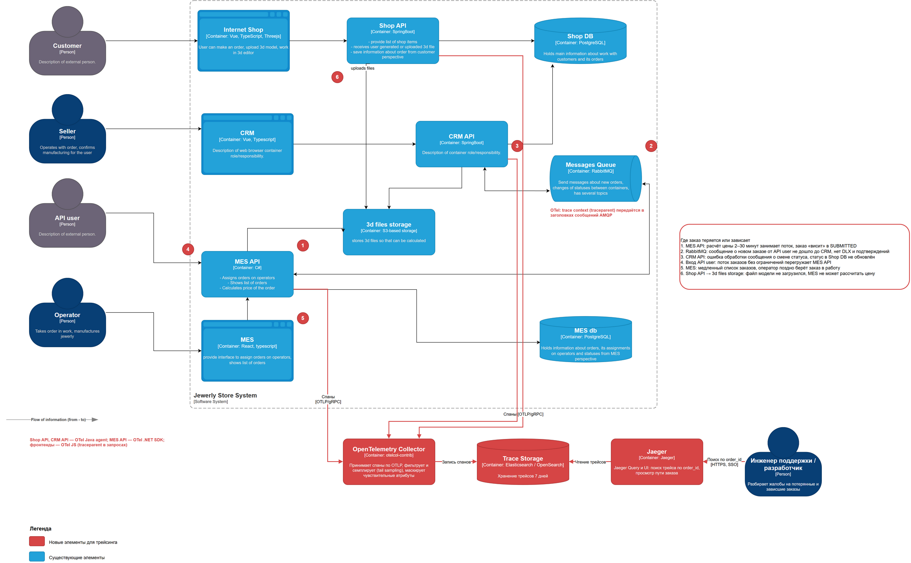
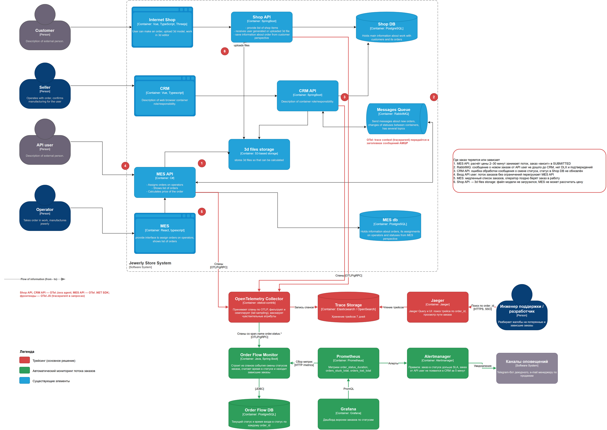

# Архитектурное решение по трейсингу

## Мотивация

Заказ проходит через пять компонентов: интернет-магазин, Shop API, CRM API, RabbitMQ и MES API. Часть пути синхронная (HTTP), часть асинхронная (сообщения). Сейчас, когда API user сообщает о пропавшем заказе, команда вручную ищет его в логах трёх инстансов и двух БД. Часто так и не удаётся понять, где он потерялся.

**Трейсинг** — запись пути одного запроса через все системы. Каждый шаг (span) хранит время начала, длительность, сервис и результат. Все шаги одного заказа связаны общим trace_id.

Что даёт трейсинг:

- **Для поддержки:** по order_id за минуту находится весь путь заказа и шаг, на котором он упал или завис.
- **Для разработки:** видно, какой шаг занимает время. Например, расчёт цены, запрос к БД или ожидание в очереди.
- **Для бизнеса:** меньше потерянных заказов и быстрее реакция на жалобы, что помогает удержать B2B-клиентов.

### Метрики, на которые повлияет трейсинг

| Метрика | Тип | Как изменится |
|---|---|---|
| Время поиска причины по жалобе на заказ (MTTD/MTTR) | Техническая | С часов до минут: поиск по order_id в Jaeger вместо ручного просмотра логов |
| Количество потерянных заказов API users в месяц | Бизнес | Снижается: каждый обрыв трейса указывает на конкретное место потери, причины устраняются |
| Доля заказов, выполненных в срок 3 недели | Бизнес | Растёт: видно, на каком шаге заказ проводит больше всего времени |
| Количество жалоб API users в день | Бизнес | Снижается вслед за потерями |
| p95 длительности сквозного создания заказа (от API до CRM) | Техническая | Становится измеримой. Сейчас её нельзя посчитать |

## Какие системы покрываются

На схеме красными кружками с номерами отмечены места, где заказ теряется или зависает. Трейсинг покрывает все эти места.

| Система | Что трейсится | Почему |
|---|---|---|
| Internet Shop, CRM, MES (фронтенды) | Действия пользователя, исходящие HTTP-запросы с заголовком `traceparent` | Трейс начинается там, где пользователь нажал кнопку. Видно, сколько занял ответ для человека |
| Shop API | Входящие HTTP-запросы, запись в Shop DB, загрузка файлов в S3 | Создание заказа и загрузка 3D-модели (точка 6) |
| CRM API | Входящие HTTP-запросы, обработка и публикация сообщений RabbitMQ, запросы в Shop DB | Создание заказа из сообщения MES (точка 3), смена статусов |
| MES API | Входящие запросы операторов и API users, расчёт цены, чтение из S3, запросы в MES DB, публикация в RabbitMQ | Самый нагруженный компонент: расчёт цены (точка 1), вход API users (точка 4), список заказов (точка 5) |
| RabbitMQ | Не создаёт спаны сам. Контекст трейса передаётся в заголовках сообщений, отправитель и получатель создают спаны publish и consume | Связывает синхронную и асинхронную части (точка 2) |
| Shop DB, MES DB, S3 | Спаны создаются на стороне клиента (JDBC, Npgsql, S3 SDK) | Видно время запросов и ошибки без доработки БД |

Схема с отмеченными местами и новыми элементами:

- [tracing-c4.drawio](tracing-c4.drawio)

| № | Место | Что происходит |
|---|---|---|
| 1 | MES API, расчёт цены | Расчёт 2–30 минут занимает поток, заказ «висит» в SUBMITTED |
| 2 | RabbitMQ | Сообщение о новом заказе от API user не доходит до CRM: нет DLX и подтверждений |
| 3 | CRM API | Ошибка при обработке сообщения о смене статуса, статус в Shop DB не обновлён |
| 4 | Вход API user в MES API | Поток заказов без ограничений перегружает MES API |
| 5 | MES (список заказов) | Медленный список, оператор поздно берёт заказ |
| 6 | Shop API → S3 | Файл модели не загрузился, MES не может рассчитать цену |

## Какие данные записываются в трейсы

**Стандартные атрибуты OpenTelemetry:** сервис, версия, окружение, HTTP-метод, маршрут, код ответа, длительность, ошибка и её тип, имя очереди и exchange, тип операции с БД.

**Бизнес-атрибуты:**

| Атрибут | Пример | Зачем |
|---|---|---|
| `order.id` | `ORD-2024-15342` | Поиск трейса по номеру заказа из жалобы |
| `order.status.from`, `order.status.to` | `SUBMITTED` → `PRICE_CALCULATED` | Видно, на каком переходе сбой |
| `order.source` | `shop`, `api` | Отличать заказы покупателей от заказов API users |
| `api.client_id` | `partner-17` | Найти, у какого клиента API проблемы |
| `customer.id` | `c-98231` (внутренний идентификатор) | Связать с обращением клиента. Не ФИО и не контакты |
| `price.calculation.complexity` | `simple`, `complex` | Анализ длительности расчёта |
| `operator.id` | `op-12` | Кто взял заказ в работу |
| `messaging.message.id`, `messaging.retry_count` | `9f1c…`, `2` | Повторы и дубли сообщений |

Смена статуса заказа оформляется отдельным спаном с именем `order.status.<НОВЫЙ_СТАТУС>`. Это позволяет анализировать поток заказов автоматически.

## Предлагаемое решение

### Технологии

| Компонент | Технология | Почему |
|---|---|---|
| Инструментация Java (Shop API, CRM API) | OpenTelemetry Java agent | Автоматически трейсит Spring MVC, JDBC, RabbitMQ (Spring AMQP), S3 без правок кода. Бизнес-атрибуты добавляются через API OTel |
| Инструментация C# (MES API) | OpenTelemetry .NET SDK + инструментации ASP.NET Core, HttpClient, Npgsql, RabbitMQ | Официальная поддержка .NET, тот же стандарт |
| Инструментация фронтендов | OpenTelemetry JS (web) | Начинает трейс в браузере и передаёт `traceparent` в API |
| Передача контекста | W3C Trace Context: заголовок `traceparent` в HTTP и в headers сообщений AMQP | Стандарт, поддерживается всеми SDK. Связывает HTTP и очереди в один трейс |
| Сбор | OpenTelemetry Collector (contrib) | Единая точка приёма, семплирование, маскирование, отправка в любое хранилище. Приложения не зависят от бэкенда трейсинга |
| Хранилище | Elasticsearch / OpenSearch | Масштабируется, поддерживается Jaeger. Можно использовать тот же кластер OpenSearch, что и для логов, в отдельных индексах |
| Просмотр | Jaeger Query + UI | Открытый, бесплатный, поиск по тегам (`order.id`), сравнение трейсов |

Почему OpenTelemetry, а не проприетарные агенты: это открытый стандарт. Его поддерживают Java и .NET, а бэкенд (Jaeger, Grafana Tempo, коммерческие системы) можно заменить без изменения кода.

### Компоненты

1. **SDK и агенты в приложениях** создают спаны и отправляют их по OTLP в Collector.
2. **OpenTelemetry Collector:**
   - принимает OTLP;
   - пакетирует;
   - удаляет и маскирует чувствительные атрибуты;
   - применяет tail sampling: сохраняет 100% трейсов с ошибками и медленных (> 5 с) и 100% трейсов с атрибутом `order.id`, остальные — 10%;
   - отправляет в хранилище.
3. **Хранилище трейсов** — индексы по дням, хранение 7 дней. Трейсы ошибок экспортируются в логи на больший срок.
4. **Jaeger Query и UI** — поиск и просмотр трейсов.

### Обновлённая C4-диаграмма контейнеров

Новые элементы выделены красным: [tracing-c4.drawio](tracing-c4.drawio) (PNG выше).

### Как это работает на примере заказа API user

1. API user вызывает `POST /orders` в MES API. Создаётся корневой спан с `order.id` и `api.client_id`.
2. MES API запускает расчёт цены (дочерний спан `price.calculate`), читает модель из S3 (спан S3 GetObject), пишет в MES DB.
3. MES API публикует сообщение в RabbitMQ (спан `publish`). Заголовок `traceparent` уходит в сообщение.
4. CRM API получает сообщение (спан `consume`, продолжает тот же трейс), создаёт заказ в Shop DB, публикует смену статуса.
5. Если на шаге 4 произошла ошибка, спан помечается `error`. В Jaeger по `order.id` видно: сообщение опубликовано, получено CRM, обработка упала с конкретной ошибкой.

## Компромиссы

| Решение | Плюсы | Минусы и как их снижаем |
|---|---|---|
| Tail sampling вместо сохранения всех трейсов | Объём хранилища в разы меньше | Collector держит трейсы в памяти до решения. Нужен запас памяти, при горизонтальном масштабировании — балансировка по trace_id |
| Хранение 7 дней | Дешевле | Старые заказы нельзя разобрать по трейсам. Для долгих заказов (недели) остаются логи с order_id и бизнес-метрики |
| Автоматическая инструментация | Быстрое внедрение без правок кода | Не видны бизнес-шаги. Поэтому бизнес-спаны смены статуса добавляются вручную |
| Длинный расчёт цены в одном трейсе | Видно всё в одном месте | Трейсы длиной в десятки минут неудобны. После перехода на асинхронный расчёт трейс разделится на связанные через span links |
| Накладные расходы | — | Инструментация добавляет 1–3% CPU и небольшую задержку. Экспорт асинхронный и пакетный, при недоступности Collector спаны отбрасываются, а не блокируют приложение |
| Ещё одна система для эксплуатации | — | Хранилище совмещается с кластером логов. Для Collector и Jaeger настраиваются мониторинг и алерты |

## Безопасность

1. **Без персональных данных в трейсах.** Не записываются ФИО, телефоны, e-mail, адреса, тела запросов, содержимое 3D-моделей и токены. В атрибутах только внутренние идентификаторы (`customer.id`, `order.id`).
2. **Маскирование на Collector.** Processor `attributes` / `redaction` удаляет заголовки `Authorization`, `Cookie` и query-параметры с токенами, даже если их случайно записал агент.
3. **Шифрование.** Приложения отправляют спаны в Collector по TLS. Хранилище шифрует данные на диске (managed-сервис Yandex Cloud).
4. **Доступ к Jaeger UI** — только через SSO компании. Разработчики и поддержка — чтение, DevOps — администрирование. Jaeger UI не публикуется в интернет.
5. **Сетевой доступ.** Collector принимает данные только из внутренних подсетей приложений. Хранилище доступно только Collector и Jaeger.
6. **Контекст от внешних клиентов.** Входящий `traceparent` от API users не используется как родитель: MES API начинает новый трейс и сохраняет внешний идентификатор в атрибуте. Так внешний клиент не может подмешать данные в наши трейсы.
7. **Аудит.** Доступ к Jaeger UI журналируется.

## Дополнительно: автоматический мониторинг потока заказов по трейсам

Трейсы хранят спаны смены статуса (`order.status.*`). На их основе можно автоматически следить за заказами и не ждать жалоб. Новые элементы выделены зелёным:

- [tracing-order-flow-monitoring.drawio](tracing-order-flow-monitoring.drawio)

**Компоненты:**

| Компонент | Назначение |
|---|---|
| Order Flow Monitor (Java, Spring Boot) | Получает из Collector отдельным pipeline только спаны `order.status.*`. Хранит текущий статус и время входа в статус по каждому заказу. Раз в минуту ищет заказы, которые нарушили ожидания |
| Order Flow DB (PostgreSQL) | Состояние заказов для мониторинга: `order_id`, `status`, `entered_at`, `source`, `api_client` |
| Prometheus | Собирает метрики монитора: `order_status_duration_seconds`, `orders_stuck_total{status}`, `orders_lost_total{api_client}` |
| Alertmanager | Отправляет алерты в Telegram-бот дежурного и на почту менеджеру клиента |
| Grafana | Дашборд воронки заказов по статусам и списки зависших заказов |

**Правила обнаружения:**

| Правило | Условие | Алерт |
|---|---|---|
| Потерянный заказ API user | Есть спан создания заказа в MES API, но нет `order.status.*` из CRM за 5 минут | Критичный, дежурному: номер заказа, клиент API, ссылка на трейс |
| Зависание в SUBMITTED | Нет `PRICE_CALCULATED` за 1 час | Предупреждение, критичный после 4 часов |
| Зависание в PRICE_CALCULATED | Продавец не подтвердил производство за 1 рабочий день | Продавцу и руководителю продаж |
| Оператор не взял заказ | Нет `MANUFACTURING_STARTED` за 4 часа после `MANUFACTURING_APPROVED` | Руководителю производства |
| Ошибка в трейсе заказа | Спан с `error=true` и атрибутом `order.id` | Предупреждение в чат команды |

Так команда узнаёт о проблеме с конкретным заказом раньше клиента. Метрики времени в статусах показывают, где процесс системно замедляется.
