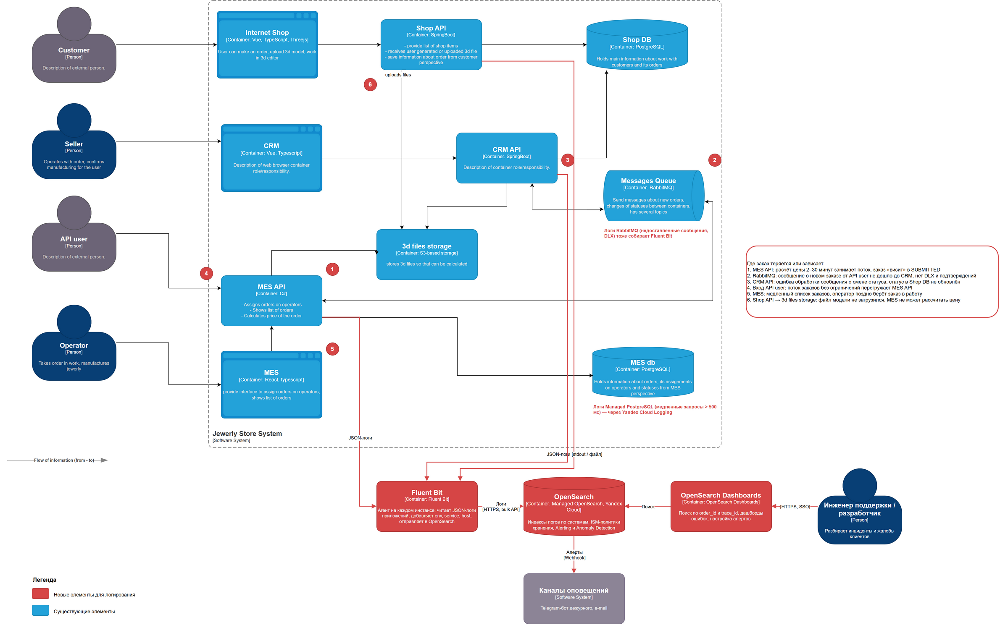

# Архитектурное решение по логированию

## Какие логи собирать

Логи собираются со всех систем, через которые проходит заказ. На схеме [logging-c4.drawio](logging-c4.drawio) новые элементы выделены красным, красными кружками отмечены места, где заказы теряются или зависают.

| Система | Какие логи | Зачем |
|---|---|---|
| MES API | Логи приложения: запросы API users и операторов, расчёт цены, смена статусов, публикация в RabbitMQ, ошибки | Самый проблемный компонент: расчёт цены, поток заказов от API users, медленный список |
| CRM API | Логи приложения: обработка сообщений RabbitMQ, создание заказов, смена статусов, ошибки | Здесь теряются заказы от API users |
| Shop API | Логи приложения: создание заказа, загрузка 3D-модели, смена статусов, ошибки | Начало пути заказа покупателя |
| RabbitMQ | Логи брокера: отклонённые и просроченные сообщения, отключения потребителей, срабатывание лимитов | Видно, почему сообщение не доставлено |
| Shop DB, MES DB | Медленные запросы (> 500 мс), блокировки, ошибки соединений — через Yandex Cloud Logging | Причины медленной главной страницы MES |
| Фронтенды (Internet Shop, CRM, MES) | Только ошибки JavaScript, отправляются через API | Ошибки у пользователя, которые не видны на сервере |
| API Gateway (после внедрения) | Access-логи: клиент API, маршрут, код ответа, время | Активность и ошибки API users |

Все логи приложений пишутся в **структурированном JSON** с обязательными полями: `timestamp`, `level`, `service`, `env`, `host`, `trace_id`, `span_id`, `message`. Для событий заказа добавляется `order_id`. Поле `trace_id` связывает логи с трейсами: из Jaeger можно перейти к логам шага, из лога — к трейсу.

## Логи уровня INFO

INFO — нормальные бизнес-события, по которым можно восстановить историю заказа.

| Система | Событие | Поля |
|---|---|---|
| Shop API | Заказ создан (INITIATED) | время, `order_id`, `customer_id`, источник (shop) |
| Shop API | Файл модели загружен (FILE_UPLOADED) | время, `order_id`, `customer_id`, размер файла, ключ объекта в S3 |
| Shop API | Заказ отправлен (SUBMITTED) | время, `order_id`, `customer_id` |
| MES API | Заказ получен от API user | время, `order_id`, `api_client_id`, внешний номер заказа клиента |
| MES API | Начат расчёт цены | время, `order_id`, сложность модели |
| MES API | Цена рассчитана (PRICE_CALCULATED) | время, `order_id`, `customer_id`, длительность расчёта, сумма |
| CRM API | Заказ создан по сообщению MES | время, `order_id`, `api_client_id`, `message_id` |
| CRM API | Производство подтверждено (MANUFACTURING_APPROVED) | время, `order_id`, `customer_id`, `seller_id` |
| MES API | Заказ взят оператором (MANUFACTURING_STARTED) | время, `order_id`, `operator_id` |
| MES API | Изготовлен, упаковка, отправка (MANUFACTURING_COMPLETED, PACKAGING, SHIPPED) | время, `order_id`, `operator_id`, номер отправления для SHIPPED |
| CRM API | Заказ закрыт (CLOSED) | время, `order_id`, `customer_id`, способ закрытия (транспортная компания, вручную), `seller_id` для ручного закрытия |
| Все API | Сообщение опубликовано / получено из RabbitMQ | время, `order_id`, `message_id`, очередь, `trace_id` |
| Все API | Запуск и остановка сервиса | время, версия, окружение |
| MES API | Изменение квот и настроек API user | время, `api_client_id`, кто изменил |

Для всех событий смены статуса используется единый формат: `order_status_changed`, `status_from`, `status_to`. Это позволяет строить по логам воронку заказов.

## Другие уровни логирования

| Уровень | Когда используется | Примеры | Где включён |
|---|---|---|---|
| ERROR | Операция не выполнена, нужно вмешательство | Исключение при обработке сообщения, отказ БД, ошибка расчёта цены, сообщение ушло в DLX | Везде, всегда |
| WARN | Операция выполнена, но с отклонением, которое может привести к проблеме | Повторная попытка отправки, медленный запрос к БД, расчёт дольше 10 минут, приближение к квоте API user, дубль сообщения отброшен | Везде, всегда |
| INFO | Бизнес-события и жизненный цикл сервиса | Таблица выше | Везде, всегда |
| DEBUG | Детали для разработчиков: параметры вызовов, промежуточные значения расчёта | Входные параметры расчёта цены, SQL-запросы | dev и release. В prod — временно для одного сервиса при разборе инцидента, с автоматическим выключением через 1 час |
| TRACE | Максимальная детализация | Тело сообщения RabbitMQ без персональных данных | Только локально и в dev |

## Мотивация

Сейчас каждая система пишет логи в файл на своём инстансе. Чтобы разобраться с жалобой, разработчик заходит на несколько серверов и ищет по тексту. Формат логов разный, номера заказа может не быть. Пока ищут, логи ротируются и пропадают.

Централизованное логирование нужно, чтобы:

- найти все события заказа во всех системах одним запросом по `order_id`;
- видеть ошибки сразу после релиза и получать алерты;
- иметь историю заказа на весь срок его выполнения (недели), в отличие от трейсов, которые хранятся 7 дней;
- закрыть требования безопасности: кто и когда менял заказ.

Логирование и трейсинг дополняют друг друга. Трейсинг показывает путь и время, логи — подробности: что именно сломалось и с какими данными.

### Метрики, на которые повлияет логирование

| Метрика | Тип | Как изменится |
|---|---|---|
| Время поиска причины инцидента (MTTR) | Техническая | Снижается: поиск по `order_id` и `trace_id` в одном месте вместо ручного обхода серверов |
| Количество ошибок, о которых узнали от клиентов, а не от алертов | Техническая | Снижается: алерты на ERROR и аномалии |
| Время ответа на жалобу API user | Бизнес | Снижается: поддержка сама видит историю заказа |
| Количество потерянных заказов | Бизнес | Снижается: каждая потеря разбирается и устраняется |
| Время выпуска исправления | Техническая | Снижается: причина бага видна сразу, не нужно воспроизводить |

## Приоритет внедрения логирования и трейсинга

| Очередь | Система | Почему |
|---|---|---|
| 1 | **MES API** | Самая большая боль: расчёт цены, поток заказов от API users, медленный список операторов. Все жалобы API users начинаются здесь |
| 2 | **CRM API** | Здесь создаются заказы API users по сообщениям из очереди, здесь они и теряются. Без логов CRM нельзя закрыть основную жалобу |
| 3 | **RabbitMQ** | Связывает MES и CRM. Логи брокера и DLX объясняют потерю сообщений |
| 4 | **Shop API** | Путь покупателя работает стабильнее, но B2C-недовольство растёт. Нужен для полной картины заказа |
| 5 | **БД и фронтенды** | Медленные запросы нужны для оптимизации MES, ошибки фронтендов — для качества интерфейса |

MES API и CRM API подключаются первыми в одном спринте: путь заказа API user проходит через обе системы, и только вместе они дают ответ, где он потерялся.

## Предлагаемое решение

### Технологии

| Компонент | Технология | Почему |
|---|---|---|
| Формат логов | JSON: Logback + logstash-logback-encoder (Java), Serilog + JSON formatter (C#) | Структурированные поля можно искать и агрегировать без парсинга текста |
| Корреляция | OpenTelemetry добавляет `trace_id` и `span_id` в MDC и LogContext | Связь логов и трейсов |
| Агент сбора | Fluent Bit на каждом инстансе | Лёгкий (несколько МБ памяти), читает файлы и journald, буферизует на диске при недоступности хранилища, умеет фильтровать и маскировать |
| Хранилище и поиск | Managed OpenSearch в Yandex Cloud | Открытая лицензия, managed-сервис в том же облаке, встроенные Alerting и Anomaly Detection. Сравнение ниже |
| Визуализация | OpenSearch Dashboards | Поиск, дашборды, настройка алертов |
| Логи managed PostgreSQL | Yandex Cloud Logging → экспорт в OpenSearch | Managed-БД не дают поставить агент, логи доступны через облачный сервис |

### Компоненты и поток данных

1. Приложение пишет JSON-лог в stdout. systemd сохраняет его в journald, или приложение пишет в файл с ротацией.
2. Fluent Bit читает логи и:
   - добавляет `env`, `service`, `host`;
   - удаляет и маскирует чувствительные поля;
   - отправляет пакетами в OpenSearch по HTTPS.
   
   При недоступности OpenSearch буферизует данные на диске до 1 ГБ.
3. OpenSearch раскладывает логи по индексам каждой системы. Политики ISM (Index State Management) переводят старые индексы в холодное хранение и удаляют их по сроку.
4. OpenSearch Dashboards используется для поиска и дашбордов.
5. OpenSearch Alerting и Anomaly Detection отправляют уведомления в Telegram и на почту через webhook.

## Политика безопасности

**Чувствительные данные**

1. В логи **не пишутся**:
   - пароли, токены, API-ключи, заголовки `Authorization` и `Cookie`;
   - номера банковских карт;
   - содержимое 3D-моделей;
   - полные тела запросов.
2. Персональные данные (ФИО, телефон, e-mail, адрес доставки) не пишутся. Вместо них используются внутренние идентификаторы `customer_id`, `seller_id`, `operator_id`. Если поле всё же нужно для разбора, оно маскируется: `+7 *** *** 12 34`, `i***@mail.ru`.
3. Fluent Bit дополнительно удаляет поля по списку запрещённых имён и маскирует значения по регулярным выражениям (карты, e-mail, телефоны). Это страховка от ошибок разработчиков.
4. Правила логирования включены в ревью кода и в автоматическую проверку: тест падает, если в лог попало поле из запрещённого списка.

**Доступ**

| Роль | Доступ |
|---|---|
| Разработчики | Чтение логов dev и release без ограничений. Чтение prod — индексы своих систем |
| Поддержка | Чтение prod-логов через сохранённые поиски по `order_id`, без DEBUG-индексов |
| DevOps | Администрирование кластера, ISM-политик и агентов |
| Специалист по ИБ | Чтение всех индексов, включая аудит доступа |
| Бизнес-пользователи | Нет прямого доступа, только дашборды с агрегатами |

- Вход только через SSO, права через ролевую модель OpenSearch Security на уровне индексов. Для поддержки — маскирование полей на уровне документа.
- Логи передаются по TLS, хранятся зашифрованными, кластер доступен только из внутренней сети.
- Доступ к логам журналируется в отдельный аудит-индекс с хранением 1 год.
- Логи prod, release и dev хранятся в разных индексах. Доступ к prod выдаётся отдельно.

## Политика хранения

Индекс создаётся на каждую систему, окружение и день. Например, `logs-mes-api-prod-2024.12.01`. Так права выдаются на уровне системы, а старые данные удаляются целыми индексами без дорогих операций удаления документов.

| Индекс | Окружение | Горячее хранение | Тёплое / холодное хранение | Удаление | Оценка объёма в день |
|---|---|---|---|---|---|
| `logs-mes-api-*` | prod | 14 дней | до 90 дней | через 90 дней | ~3 ГБ |
| `logs-crm-api-*` | prod | 14 дней | до 90 дней | через 90 дней | ~1 ГБ |
| `logs-shop-api-*` | prod | 14 дней | до 90 дней | через 90 дней | ~2 ГБ |
| `logs-rabbitmq-*` | prod | 7 дней | до 30 дней | через 30 дней | ~0,3 ГБ |
| `logs-db-*` (медленные запросы) | prod | 7 дней | до 30 дней | через 30 дней | ~0,5 ГБ |
| `logs-frontend-*` (ошибки JS) | prod | 7 дней | до 30 дней | через 30 дней | ~0,2 ГБ |
| `logs-order-events-*` (INFO смены статусов) | prod | 30 дней | до 1 года | через 1 год | ~0,1 ГБ |
| `logs-audit-*` (доступ к логам, изменения заказов) | prod | 30 дней | до 1 года | через 1 год | ~0,05 ГБ |
| `logs-*-release-*`, `logs-*-dev-*` | release, dev | 7 дней | — | через 7 дней | ~1 ГБ |

Почему так:

- 90 дней для логов prod покрывают срок выполнения заказа (до нескольких месяцев сейчас) с запасом на разбор жалоб.
- События смены статуса и аудит занимают мало места, но нужны дольше: для споров с клиентами и проверок.
- DEBUG-логи из prod попадают в отдельный индекс со сроком 3 дня.

Ограничения размера:

- индекс переходит в тёплое хранилище при достижении 30 ГБ или 1 дня;
- на кластер ставится алерт при заполнении диска на 75%.

Ожидаемый горячий объём: ~7 ГБ × 14 дней ≈ 100 ГБ, с репликой — 200 ГБ. Холодный объём — около 600 ГБ.

## Как превратить сбор логов в анализ

Логи сами по себе ничего не дают, если их никто не смотрит. Поэтому сразу настраиваются алерты, аномалии и дашборды.

**Алерты (OpenSearch Alerting)**

| Алерт | Условие | Кому |
|---|---|---|
| Рост ошибок | Более 20 ERROR в одном сервисе за 5 минут | Дежурному в Telegram |
| Сообщение в DLX | Любой лог RabbitMQ или потребителя о переводе в DLX | Дежурному |
| Заказ API user не создан в CRM | Есть событие «заказ получен от API user» в MES, но нет «заказ создан» в CRM с тем же `order_id` за 5 минут | Дежурному, критично |
| Ошибка расчёта цены | ERROR в расчёте цены | Чат команды MES |
| Подозрительная активность | Более 100 ошибок 401/403 от одного `api_client_id` за 10 минут | Специалисту по ИБ |
| Ошибки после релиза | Доля ERROR выросла вдвое за 30 минут после деплоя | Автору релиза и тимлиду |

**Поиск аномалий (OpenSearch Anomaly Detection)**

Модель Random Cut Forest строится по историческим данным и находит отклонения без ручных порогов:

- количество заказов от каждого `api_client_id` в час: резкий рост — риск перегрузки, резкое падение — у клиента проблемы с интеграцией;
- длительность расчёта цены: рост выше обычного;
- количество WARN по медленным запросам к MES DB;
- количество событий каждого статуса в час: падение `MANUFACTURING_STARTED` показывает, что операторы не берут заказы.

**Дашборды**

- Воронка заказов по статусам на основе событий `order_status_changed`.
- Ошибки по сервисам и версиям.
- Активность и ошибки по клиентам API.
- Медленные запросы к БД.

**Процесс**

- Еженедельный разбор топ-10 ошибок на планировании спринта.
- Каждый критичный алерт закрывается задачей на устранение причины.

## Дополнительно: сравнение решений

| Критерий | ELK (Elasticsearch + Logstash + Kibana) | OpenSearch | Splunk | Grafana Loki |
|---|---|---|---|---|
| Лицензия и стоимость | Elastic License / AGPL. Бесплатная базовая версия, алерты и ML — платная подписка | Apache 2.0, всё бесплатно, включая Alerting, Anomaly Detection, Security | Коммерческая, оплата за объём данных в день — дорого при росте | AGPL, бесплатно |
| Доступность в Yandex Cloud | Нет managed-сервиса от Yandex (есть Elastic Cloud вне РФ) | Есть Managed Service for OpenSearch | Нет, только SaaS или своя установка | Нет managed-сервиса, своя установка |
| Полнотекстовый поиск | Отличный | Отличный (тот же движок в основе) | Отличный, мощный язык SPL | Слабый: индексирует только метки, поиск по тексту — перебором |
| Алерты и поиск аномалий | Есть в платной версии | Есть бесплатно (плагины Alerting и Anomaly Detection) | Сильные, в том числе ML | Алерты через Grafana / Ruler, аномалий нет |
| Стоимость хранения | Высокая: полный индекс | Высокая: полный индекс, снижается ISM и холодным хранением | Очень высокая | Низкая: сжатые данные в S3 |
| Сложность эксплуатации | Средняя–высокая | Низкая при managed-сервисе | Низкая в SaaS, высокая on-premise | Средняя |
| Интеграция с трейсингом | Elastic APM, Jaeger поддерживает как хранилище | Trace Analytics, Jaeger поддерживает как хранилище | Splunk APM (отдельный продукт) | Отличная с Grafana Tempo |
| Экспертиза на рынке | Очень распространён | Совместим с ELK, навыки переносятся | Реже, дороже специалисты | Растущая |

Плюсы и минусы:

- **ELK:**
  - плюсы — зрелость, огромное сообщество;
  - минусы — ключевые для нас функции (алерты, ML) платные, нет managed-сервиса в Yandex Cloud.
- **OpenSearch:**
  - плюсы — всё нужное бесплатно, managed в нашем облаке, совместим с инструментами ELK;
  - минусы — дорогое хранение при больших объёмах, отстаёт от Elastic в части новых функций.
- **Splunk:**
  - плюсы — самый мощный анализ;
  - минусы — стоимость несоразмерна масштабу компании, сложности с доступностью в РФ.
- **Loki:**
  - плюсы — дешёвое хранение, хорошо сочетается с Grafana;
  - минусы — слабый поиск по содержимому. А нам часто нужно искать по тексту ошибки и полям без заранее заданных меток.

**Вывод:** выбран **Managed OpenSearch**. Он закрывает все требования (поиск по `order_id`, алерты, поиск аномалий, разграничение доступа) без лицензионных платежей. Managed-сервис в Yandex Cloud снимает нагрузку с единственного DevOps-инженера. Тот же кластер используется как хранилище трейсов Jaeger в отдельных индексах.
