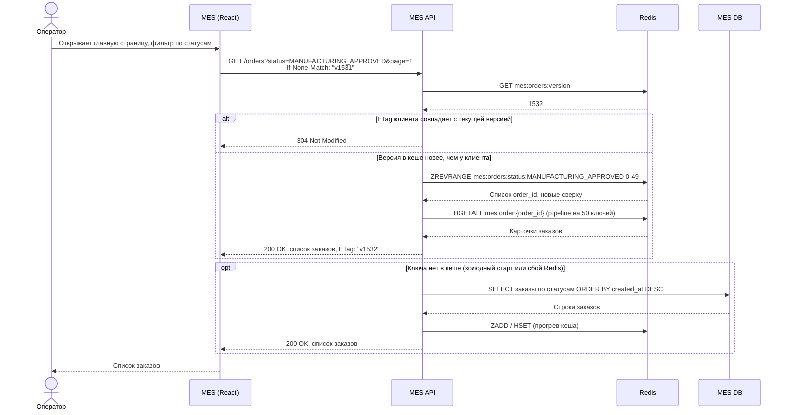
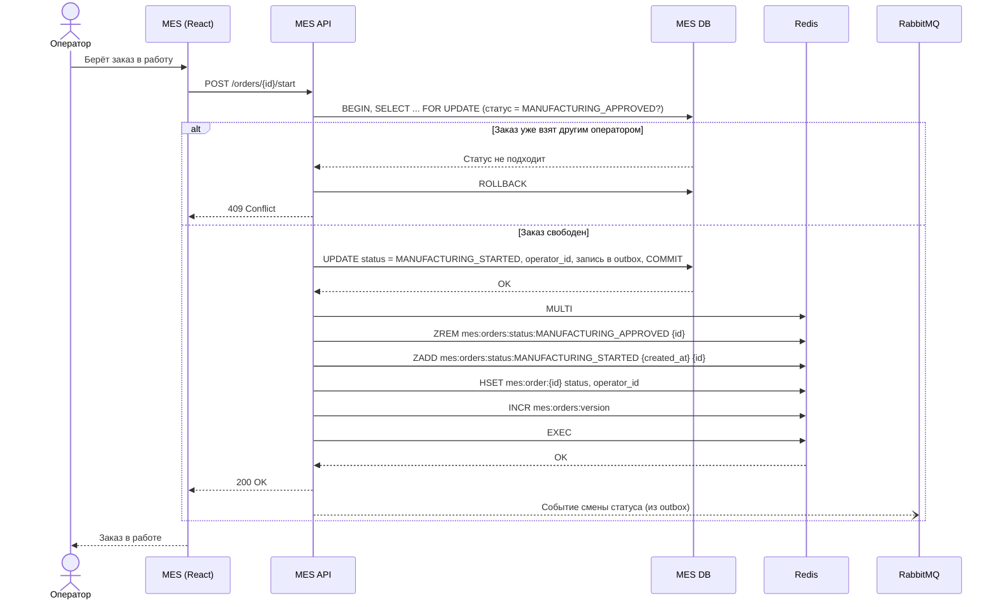

# Архитектурное решение по кешированию

## Что кешируем

Кешируется **список заказов на главной странице MES**: дашборд заказов по статусам с фильтром и сортировкой по дате создания. Его используют операторы.

Почему именно он:

- Это самый частый запрос в MES. Операторы держат страницу открытой и постоянно обновляют её, чтобы первыми взять новый заказ: кто первым взял, тот и получает оплату.
- Запрос тяжёлый: выборка по статусам с сортировкой из единственного экземпляра MES DB, который одновременно обслуживает расчёты цены и запись статусов. Фильтр и пагинация не помогли, значит проблема в нагрузке на БД, а не в объёме выдачи.
- Данные читаются намного чаще, чем меняются. Десятки операторов обновляют страницу каждые несколько секунд, а статус заказа меняется несколько раз за весь срок его жизни.

Что **не кешируем:**

- **Расчёт цены.** Результат уникален для каждой модели, повторных запросов почти нет. Проблема расчёта решается асинхронными воркерами.
- **Детальную карточку заказа в момент взятия в работу.** Здесь нужна гарантированно актуальная запись из БД с блокировкой, иначе два оператора возьмут один заказ.
- **Каталог интернет-магазина.** Он не входит в список проблем.

## Мотивация

- **Для операторов:** страница открывается за десятки миллисекунд вместо секунд. Новый заказ виден сразу, а не после долгой загрузки. Оператор быстрее берёт заказ в работу, заказ быстрее уходит в производство.
- **Для системы:** MES DB перестаёт обслуживать сотни одинаковых тяжёлых запросов в минуту. Освободившиеся ресурсы уходят на запись статусов и расчёт цены, остальные запросы MES тоже ускоряются.
- **Для бизнеса:** сокращается время между `MANUFACTURING_APPROVED` и `MANUFACTURING_STARTED`, что приближает срок выполнения заказа к трём неделям. Растёт удовлетворённость операторов, которые теряли оплату из-за медленной страницы.

Метрики эффекта:

- p95 времени ответа `GET /orders` MES API: цель < 200 мс, сейчас секунды;
- CPU и число соединений MES DB;
- время от `MANUFACTURING_APPROVED` до `MANUFACTURING_STARTED`;
- доля запросов, обслуженных из кеша (hit ratio): цель > 90%.

## Предлагаемое решение

### Клиентское или серверное кеширование

| Вариант | Подходит? | Почему |
|---|---|---|
| Клиентское (браузер, HTTP-кеш, `Cache-Control`) | Нет, как основной механизм | Каждый оператор кеширует у себя. Нагрузка на БД снижается мало, а оператор может видеть устаревший список и не заметить новый заказ, что для него критично. Используется только `ETag` / `304 Not Modified`, чтобы не передавать список повторно, если он не изменился |
| Серверное (распределённый кеш рядом с MES API) | Да | Один кеш на всех операторов: тяжёлый запрос к БД выполняется один раз. Сервер сам обновляет кеш при смене статуса, поэтому все видят актуальные данные. Работает при нескольких инстансах MES API |

**Выбор:** серверное кеширование в **Redis**.

### Структура кеша

| Ключ | Тип Redis | Содержимое |
|---|---|---|
| `mes:orders:status:{STATUS}` | Sorted set | `order_id` с весом = время создания заказа. Сортировка «новые сверху» и пагинация через `ZREVRANGE` |
| `mes:order:{order_id}` | Hash | Краткая карточка для списка: номер, статус, дата, клиент, сложность, назначенный оператор |
| `mes:orders:version` | String (счётчик) | Версия списка для `ETag` в ответе клиенту |

Фильтр оператора по статусам — это объединение нужных sorted set, без запроса в БД.

### Выбор паттерна

| Паттерн | Как работает | Подходит? |
|---|---|---|
| **Write-Through** | При каждой записи сервис синхронно обновляет и БД, и кеш | **Да, выбран** |
| Cache-Aside | Сервис читает из кеша, при промахе — из БД и кладёт в кеш. При записи кеш инвалидируется | Нет, как основной |
| Refresh-Ahead | Кеш заранее обновляется перед истечением TTL | Нет |

**Почему Write-Through:**

- **Свежесть данных критична.** Операторы соревнуются за новые заказы. При Write-Through новый заказ или смена статуса попадает в кеш в момент записи, и все операторы сразу видят изменение.
- **Чтение никогда не идёт в БД.** Список всегда целиком в кеше, промахов в обычной работе нет. Тяжёлый запрос к MES DB выполняется только при первичном прогреве и восстановлении.
- **Запись редкая.** Статус меняется несколько раз за жизнь заказа. Дополнительная запись в Redis (единицы миллисекунд) не влияет на производительность.
- **Все записи проходят через MES API:** создание заказа (от API users и по сообщению из CRM), смена статуса оператором, результат расчёта цены. Значит, точек, где нужно обновлять кеш, немного и они под нашим контролем.

**Почему не Cache-Aside:**

- После каждой инвалидации первый запрос идёт в БД с тем же тяжёлым запросом. Статусы меняются постоянно, поэтому кеш часто пустой именно тогда, когда появился новый заказ и все операторы одновременно обновляют страницу. Это эффект «стада» (cache stampede) на БД.
- Если инвалидацию заменить коротким TTL, оператор видит устаревший список и пропускает новый заказ.
- Cache-Aside используется только как резервный путь: если ключа нет (Redis перезапущен), MES API читает из БД и прогревает кеш.

**Почему не Refresh-Ahead:**

- Паттерн обновляет данные по времени, а наши данные меняются по событиям. Между обновлениями список устаревает, а частое обновление всего списка нагружает БД так же, как сейчас.
- Он хорош для данных, которые меняются предсказуемо (курсы, справочники), а не для потока заказов.

### Диаграммы последовательности

**Чтение списка заказов оператором**

**Смена статуса заказа (запись)**

Важно: взятие заказа в работу проверяется **по БД с блокировкой строки**, а не по кешу. Кеш нужен для быстрого показа списка, а решение «кому достался заказ» принимает БД. Это исключает ситуацию, когда два оператора берут один заказ.

**Какие сущности кешируются:**

- списки `order_id` по статусам (sorted set);
- краткие карточки заказов для списка (hash);
- версия списка.

Не кешируются: полная карточка заказа, 3D-модель, история статусов, данные клиента.

### Стратегия инвалидации

Основная стратегия — **программная инвалидация по событию записи (Write-Through)**: кеш обновляется в момент изменения статуса. Дополнительно используются **TTL** как страховка и **ключевая инвалидация** через версию.

| Стратегия | Как работает | Плюсы | Минусы | Применение у нас |
|---|---|---|---|---|
| По времени (TTL) | Запись живёт фиксированное время | Просто, само восстанавливается после ошибок | Данные устаревают до истечения TTL, при истечении — нагрузка на БД | Страховка: TTL 24 часа на карточки и 1 час на списки. Фоновая сверка пересобирает списки и продлевает TTL до его истечения, поэтому в обычной работе ключи не пропадают. Если обновление кеша потерялось, расхождение живёт не дольше TTL |
| По запросу | Клиент или администратор явно просит обновить данные | Полный контроль | Требует ручного действия, не защищает от устаревания | Административная команда «пересобрать кеш» для DevOps после аварий и миграций |
| По изменению данных (событийная) | Кеш обновляется, когда меняются данные в источнике, например по CDC или событию из очереди | Актуальность без участия кода записи | Нужна инфраструктура событий, есть задержка доставки | Для изменений, которые приходят не через MES API (например, CLOSED из CRM): MES API получает событие из RabbitMQ и обновляет кеш |
| Программная | Код, который меняет данные, сам обновляет или удаляет записи в кеше | Немедленная актуальность, точечные изменения | Легко забыть обновить кеш в новом месте кода | **Основная.** Все записи статусов в MES API идут через один сервис `OrderStatusService`, который обновляет и БД, и кеш |
| По ключу (версия) | В ключ или ETag добавляется версия, при изменении версия увеличивается | Старые данные просто перестают использоваться, нет гонок удаления | Нужен счётчик версий, старые ключи надо чистить | Версия `mes:orders:version` для `ETag`: браузер получает 304, если список не изменился |

**Защита от рассинхронизации:**

1. Если запись в БД прошла, а в Redis — нет (Redis недоступен), запись в БД не откатывается. Ключи затронутого заказа удаляются при следующей попытке, а фоновая задача раз в минуту сверяет заказы, изменённые за последние 5 минут (по `updated_at`), с кешем.
2. Если Redis недоступен целиком, MES API переходит на чтение из БД (Cache-Aside как резервный путь) с ограничением частоты запросов. Срабатывает алерт.
3. Метрики кеша:
   - hit ratio;
   - количество расхождений, найденных сверкой;
   - время обновления кеша.

### Развёртывание

- Managed Service for Redis в Yandex Cloud: 2 узла (primary + replica), автоматическое переключение.
- Объём: 10 тысяч активных заказов × ~1 КБ ≈ 10 МБ. Достаточно минимального класса хоста.
- Политика вытеснения `noeviction`: список заказов не должен молча теряться. Объём контролируется TTL и алертом на 70% памяти.
- Доступ только из подсети MES API, TLS и пароль из хранилища секретов.

## Дополнительно: сравнение решений для кеширования

| Критерий | Redis | Memcached | Hazelcast | In-process кеш (MemoryCache .NET) |
|---|---|---|---|---|
| Структуры данных | Строки, hash, sorted set, списки, pub/sub | Только ключ-значение | Map, очереди, распределённые структуры | Объекты в памяти процесса |
| Сортированный список «новые сверху» | Нативно: sorted set, `ZREVRANGE` | Нет, весь список хранится одним значением и перезаписывается целиком | Через запросы к map, сложнее | Да, но отдельно в каждом инстансе |
| Работа при нескольких инстансах MES API | Общий кеш | Общий кеш | Общий кеш (кластер внутри приложений) | Нет: у каждого инстанса свой кеш, нужна синхронизация |
| Атомарные операции | `MULTI` / `EXEC`, Lua-скрипты | Только CAS на одно значение | Транзакции, entry processors | Блокировки в коде |
| Отказоустойчивость | Репликация, Sentinel / Cluster | Нет репликации | Репликация партиций | Теряется при перезапуске |
| Managed-сервис в Yandex Cloud | Есть | Нет | Нет | Не нужен |
| Поддержка в .NET и Java | StackExchange.Redis, Spring Data Redis | Есть клиенты, менее развиты | Лучше в Java, клиент .NET слабее | Встроено |
| Сложность эксплуатации | Низкая с managed-сервисом | Низкая | Высокая: кластер внутри приложений | Минимальная |

**Вывод:** выбран **Redis**.

- Sorted set идеально подходит для списка заказов «новые сверху» с пагинацией.
- Атомарные транзакции позволяют переносить заказ между статусами без промежуточного состояния.
- Managed-сервис в Yandex Cloud снимает нагрузку с единственного DevOps-инженера.
- Redis одинаково хорошо поддерживается в C# (MES) и Java (CRM, Shop). Это пригодится, если позже кешировать данные других систем.

Memcached не умеет нужные структуры данных и не реплицируется. Hazelcast избыточен и сложен для команды. In-process кеш не работает при горизонтальном масштабировании MES API, которое есть в целевой архитектуре.
